# Price prediction with a linear regression model

**Can price momentum predict tomorrow's return?**
A linear regression study across 98 NSE stocks, and what the answer reveals
about market efficiency.

[](https://arjun-quant-projects.vercel.app)
[](https://scikit-learn.org)
[](https://nextjs.org)
[](LICENSE)

**Interactive version:** https://arjun-quant-projects.vercel.app
&nbsp;·&nbsp; **Full numeric results:** [`results/`](results/)
&nbsp;·&nbsp; **All figures:** [`docs/figures/`](docs/figures/)

---

## Abstract

Four price-derived signals were tested as predictors of next-day returns across
98 NSE stocks: a 5-day moving average (`ma5`), a 20-day moving average (`ma20`),
the day's own return (`ret`), and the ratio between the two averages
(`ma_ratio = ma5 / ma20`), which encodes the golden and death cross as one
continuous number.

A linear regression was trained per stock on seven years of daily closes
(June 2019 to June 2026) using a strict 80/20 chronological split: roughly the
first five and a half years to learn from, the last year and a half held out and
never seen. Features were standardised with a scaler fitted on the training rows
only.

The model averaged an **R² of -0.0155** on returns and called direction correctly
**49.6%** of the time, below a coin flip, against **47.8%** for simply guessing
"up" every day. The resulting average edge of **+1.85 percentage points** comes
from the baseline being weak over this window rather than from the model being
good. The golden cross ratio was the largest weight for **0 of 98** stocks, its
average absolute coefficient was **0.0016**, and its sign split 61 positive to 37
negative. Of 98 per-stock edges, only **16** fall outside the ±5.4-point band
where chance alone explains the result.

The findings are consistent with the weak form of the efficient market
hypothesis. The claim being made is deliberately narrow: **these four features,
in a linear model, at a one-day horizon, on this universe, carry no information
a retail investor could act on.**

---

## Table of contents

- [1. Research question](#1-research-question)
- [2. Data](#2-data)
- [3. Method](#3-method)
- [4. Results](#4-results)
  - [4.1 The model explained nothing](#41-the-model-explained-nothing)
  - [4.2 Direction was a coin flip against a weak baseline](#42-direction-was-a-coin-flip-against-a-weak-baseline)
  - [4.3 Almost no per-stock result survives its own error bar](#43-almost-no-per-stock-result-survives-its-own-error-bar)
  - [4.4 The golden cross earned nothing](#44-the-golden-cross-earned-nothing)
  - [4.5 Size did not rescue it](#45-size-did-not-rescue-it)
- [5. Worked example: the R² trap](#5-worked-example-the-r-trap)
- [6. Interpretation](#6-interpretation)
- [7. Limitations](#7-limitations)
- [8. What I would do next](#8-what-i-would-do-next)
- [9. Reproducing this](#9-reproducing-this)
- [10. Repository layout](#10-repository-layout)

---

## 1. Research question

Momentum trading rests on a simple claim: that the recent shape of a price chart
tells you something about where the price goes next. Moving averages and the
golden cross are the most widely taught version of that claim. If it holds, it
should be measurable. If it does not, that should be measurable too.

The golden cross is the event being tested. When a fast moving average crosses
above a slow one, traders read it as bullish; the reverse is a death cross.

The question asked here is narrow on purpose, because a narrow question has a
checkable answer:

> Given only a stock's recent price history, expressed through four of the most
> widely followed technical indicators, can a linear model predict the direction
> and size of tomorrow's return better than a benchmark that requires no model
> at all?

The benchmark and the metric were both chosen **before** any model was fitted.
That ordering is the single most important methodological decision in this
project, and section 5 shows why.

## 2. Data

| | |
|---|---|
| **Universe** | 100 NSE-listed companies spanning large, mid and small caps ([`data/universe.json`](data/universe.json)) |
| **Modelled** | 98 stocks |
| **Excluded** | 2 stocks ([`data/ml-missing.json`](data/ml-missing.json)) |
| **Window** | 2019-06-01 to 2026-06-30, fixed rather than trailing |
| **Frequency** | Daily closes, split- and bonus-adjusted (`yfinance`, `auto_adjust=True`) |
| **Rows per stock** | ~1,750 trading days |
| **Test set** | ~345 days per stock |

Two names were dropped by the quality gate: `GUJGASLTD` and `JPASSOCIAT`, both
of which returned no usable price history over the window (renamed, delisted or
suspended). They are excluded with a recorded reason rather than silently
skipped. 77 of the 98 modelled stocks traded every session in the window; the
other 21 are flagged `partial` in the results, mostly late listings.

`auto_adjust=True` folds splits and bonus issues back into the history. Without
it, a 5:1 split reads as an 80% overnight crash and every return computed
afterwards is wrong. It does **not** correct demergers, and this window contains
two, both inside the test period; see [limitations](#7-limitations).


## 3. Method

**Model.** `sklearn.linear_model.LinearRegression`, fitted independently per
stock. Deliberately the simplest thing that could work: if an edge only appears
under an elaborate model, that is usually the model talking rather than the data.

**Features.** All four are computed from closes up to and including today. Only
the target looks forward.

| Feature | Definition | What it encodes |
|---|---|---|
| `ma5` | 5-day rolling mean of close | short-term trend |
| `ma20` | 20-day rolling mean of close | medium-term trend |
| `ret` | `(close_t - close_{t-1}) / close_{t-1}` | today's own move |
| `ma_ratio` | `ma5 / ma20` | the golden/death cross as a continuous number: above 1.0 the fast average leads, below 1.0 it lags, and distance from 1.0 is signal strength |

**Target.** Tomorrow's **return**, not tomorrow's price. This is the decision
that determines whether the whole study measures anything, and section 5 is
devoted to it.

**Split.** First 80% of days train, last 20% test, in date order, never
shuffled.

```
[<-- TRAIN 80% (Jun 2019 -> Jan 2025) --|-- TEST 20% (Feb 2025 -> Jun 2026) -->]
```

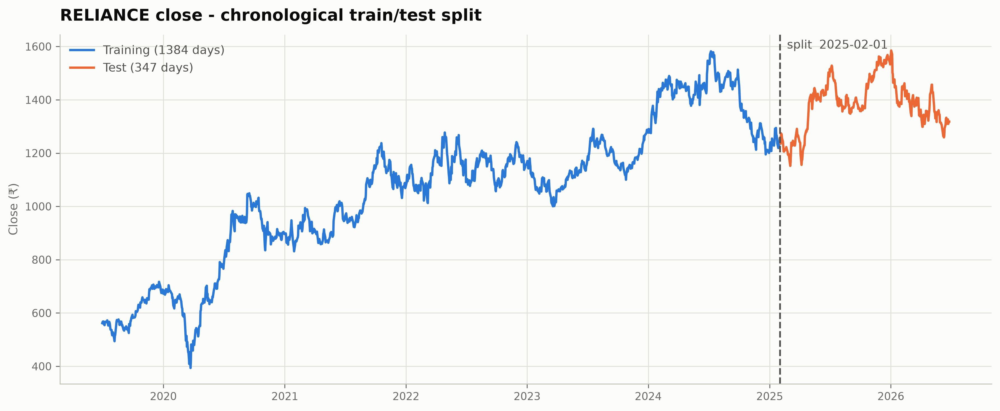

`train_test_split(shuffle=True)` is correct for independent samples and wrong
here, for two separate reasons:

1. **It leaks the future into the past.** Shuffling scatters 2026 days into the
   training set and 2024 days into the test set, so the model studies the future
   and is then examined on the past. In live use there is no future to study, so
   the resulting score measures nothing.
2. **Neighbouring rows are near-duplicates.** `ma20` on Tuesday and `ma20` on
   Wednesday share 19 of their 20 inputs. Shuffle, and Tuesday lands in train
   while Wednesday lands in test, so the model is scored on rows it has
   effectively already seen.

**Scaling.** `StandardScaler` fitted on the training rows only, then applied to
both. Fitting it on the full dataset would bake the test period's mean and
spread into the training transform. That is the same leak wearing a quieter
disguise.

**Evaluation.** R² on returns, directional accuracy, and the **edge** over an
always-guess-up baseline. Every score is read against that baseline rather than
against zero, because in a rising market "up" is a genuinely hard benchmark, and
in a flat market it is an easy one. Reading accuracy without its baseline is how
a 52% model gets mistaken for a good one.

## 4. Results

Headline figures, all computed across the 98 modelled stocks:

| Metric | Value |
|---|---|
| Average R² on next-day returns | **-0.0155** |
| Stocks with R² above zero | 17 of 98 |
| R² range across stocks | -0.130 to +0.042 |
| Average directional accuracy | **49.6%** |
| Average naive (always-up) baseline | **47.8%** |
| Average edge over baseline | **+1.85 pts** |
| Stocks beating their own baseline | 68 of 98 |
| Directional accuracy range | 41.3% to 55.3% |
| Average test-set length | 345 days |
| Standard error on one accuracy figure | ±2.7 pts |
| Stocks outside the ±5.4-pt noise band | **16 of 98** |
| `ma_ratio` was the largest weight for | **0 of 98** stocks |
| `ma_ratio` mean absolute coefficient | 0.0016 |
| `ma_ratio` sign split | 61 positive / 37 negative |

### 4.1 The model explained nothing

R² is the share of variation in tomorrow's move the model accounts for. Zero
means none at all. The average here is **-0.0155**, which is *below* zero,
meaning that on average the model did slightly worse than predicting the same
average return every single day.

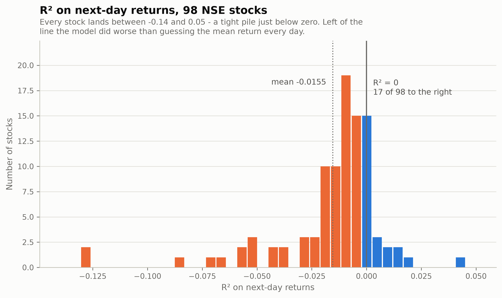

The distribution is the point. Every stock lands between -0.13 and +0.04: a
tight pile just below zero. There is no tail of stocks where the model worked,
and 17 of the 98 that clear zero clear it by a margin too small to matter.

### 4.2 Direction was a coin flip against a weak baseline

R² punishes a model for missing the size of a move. Direction is the easier
question and the one a decision actually rests on: buy or not. The model called
it correctly **49.6%** of the time.

Read that number on its own before reading anything else. After seven years of
training data, the model calls tomorrow's direction correctly **less than half
the time.**

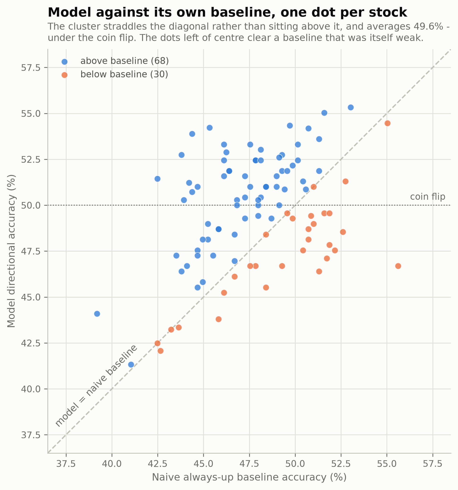

The nominal edge is *positive*, at +1.85 points, and 68 of 98 stocks beat their
own baseline. That looks like a result and is not one. The always-up rule only
scored 47.8% here because the test window was close to flat, so the benchmark
was unusually easy to beat. **Beating a poor benchmark from below a coin flip is
not skill.** This is precisely why the edge is reported next to the raw accuracy
rather than instead of it.

### 4.3 Almost no per-stock result survives its own error bar

With ~345 test days per stock, treating each day as a coin flip gives a standard
error on any single accuracy figure of about **2.7 points**. Two standard errors
is ±5.4 points, and any edge inside that band is indistinguishable from luck.

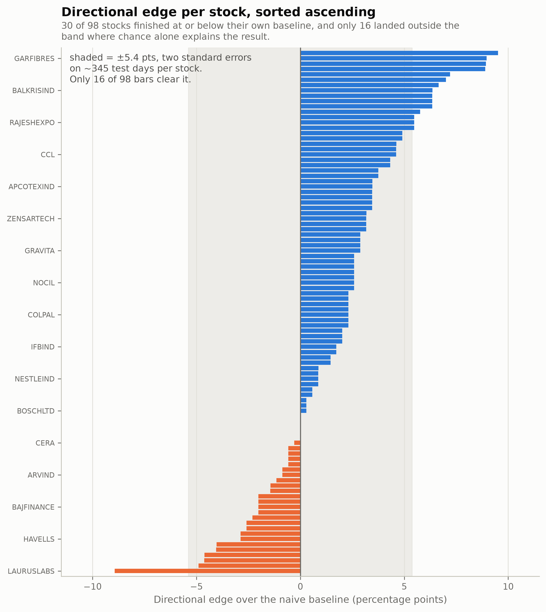

Only **16 of 98** bars clear that band, which is roughly what ranking 98 noisy
estimates produces by chance alone. The top of this table is sampling variation,
not a shortlist:

| Rank | Ticker | Edge | Model | Baseline | R² |
|---|---|---:|---:|---:|---:|
| 1 | RPOWER | +9.5 pts | 53.9% | 44.4% | -0.072 |
| 2 | GARFIBRES | +9.0 pts | 51.5% | 42.5% | +0.014 |
| 3 | HIMATSEIDE | +8.9 pts | 52.7% | 43.8% | -0.014 |
| 4 | PAYTM | +8.9 pts | 54.2% | 45.3% | -0.084 |
| 5 | CHOLAFIN | +7.2 pts | 53.3% | 46.1% | -0.005 |
| … | | | | | |
| 94 | NAVINFLUOR | -4.1 pts | 48.6% | 52.6% | -0.059 |
| 95 | FEDERALBNK | -4.6 pts | 47.6% | 52.2% | -0.025 |
| 96 | ALKEM | -4.6 pts | 47.1% | 51.7% | -0.012 |
| 97 | BAJAJCON | -4.9 pts | 46.4% | 51.3% | -0.068 |
| 98 | LAURUSLABS | -8.9 pts | 46.7% | 55.6% | -0.130 |

Note the R² column on the "winners". Four of the top five have *negative* R²:
they got direction right slightly more often than their baseline while modelling
the size of the move worse than a constant guess. That is the signature of noise,
not signal. Full table in [`results/per-stock.csv`](results/per-stock.csv).

### 4.4 The golden cross earned nothing

`ma_ratio` was the single most heavily weighted feature for **0 of 98** stocks.
Not one. Its average absolute coefficient was **0.0016**, close enough to zero
that the model is effectively ignoring it, and its sign split 61 positive to 37
negative.

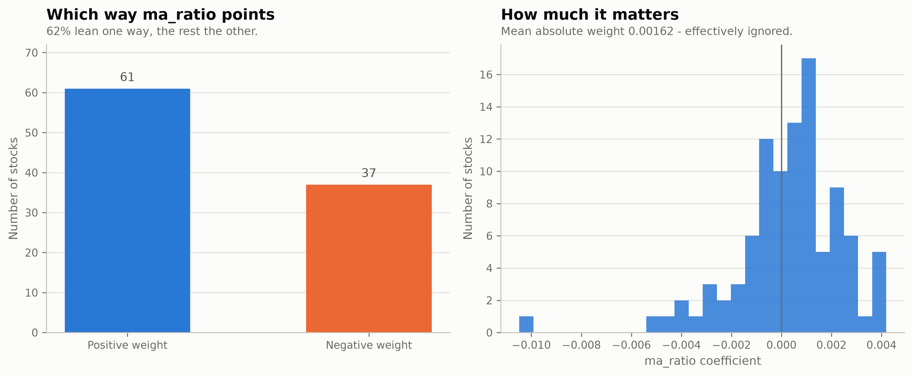

The split is the tell. A signal carrying real directional information would push
the same way for nearly every stock, golden-cross territory meaning the same
thing for Infosys as for Britannia, and would earn a weight large enough to
matter. Instead the coefficient points whichever way each stock's own noise
happens to lean, at a magnitude the model barely acts on.

Which feature *did* carry the largest weight:

| Feature | Largest weight for |
|---|---|
| `ma5` | 58 of 98 |
| `ma20` | 38 of 98 |
| `ret` | 2 of 98 |
| `ma_ratio` | **0 of 98** |

**One honest caveat on these coefficients.** `ma_ratio` is `ma5 / ma20`, a
deterministic function of two features already in the model. Near-redundant
predictors let a linear fit trade large offsetting weights between them without
changing a single prediction, so individual coefficients are unstable, and a
large one would not by itself prove the cross signal mattered. That cuts both
ways, and it is why the argument above rests on directional accuracy against the
baseline rather than on the weights alone.

### 4.5 Size did not rescue it

Momentum is documented to bite harder in smaller, less closely watched
companies, so the universe was split by market cap. It barely mattered.

| Segment | n | Model accuracy | Baseline | Edge | Mean \|ma_ratio\| |
|---|---:|---:|---:|---:|---:|
| Large | 55 | 49.8% | 48.5% | +1.31 pts | 0.00162 |
| Mid | 17 | 48.9% | 47.2% | +1.68 pts | 0.00165 |
| Small | 26 | 49.8% | 46.7% | +3.09 pts | 0.00160 |

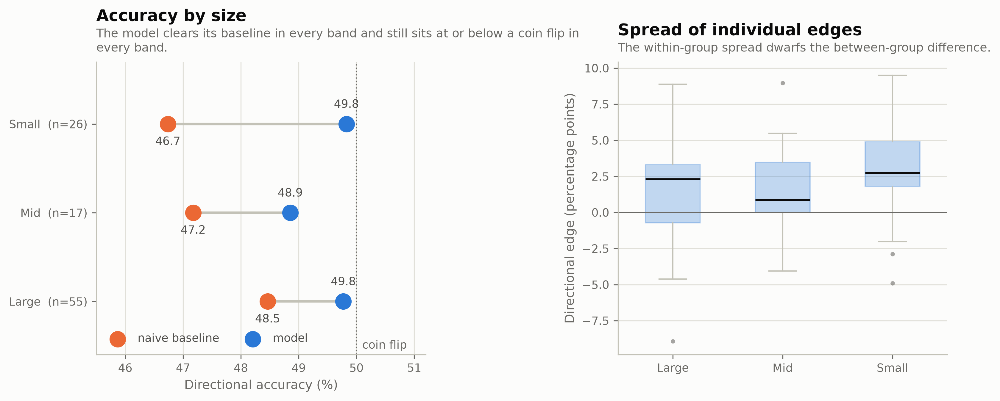

Small caps do come out ahead on nominal edge, which is the direction the
literature predicts. But their **directional accuracy is identical to the large
caps at 49.8%** - the entire difference comes from small caps having a weaker
baseline (46.7% against 48.5%), not from the model doing anything better. The
gap is baseline drift dressed as a momentum premium. And as the right-hand panel
shows, the spread of individual edges within any band dwarfs the difference
between bands.

## 5. Worked example: the R² trap

This is the most useful thing the project turned up, and it is invisible in the
aggregates. Reliance, same pipeline, trained on 2019-07-01 to 2025-01-31 and
scored on the 347 trading days from 2025-02-01 to 2026-06-26.

Two models were fitted on **identical features and an identical split.** The only
difference is what they were asked to predict: one tomorrow's *price*, the other
tomorrow's *return*. Alongside both sits the rule that requires no model at all,
"assume tomorrow closes where today closed".

| Test-set score | Price model | Naive: tomorrow = today | Return model |
|---|---:|---:|---:|
| MAE | ₹18.23 | **₹13.26** | 0.0097 |
| RMSE | ₹23.70 | **₹18.08** | 0.0133 |
| R² | 0.9363 | **0.9629** | -0.0080 |
| Directional accuracy | 47.0% | 51.6% | 51.0% |

MAE and RMSE for the first two columns are in rupees and directly comparable.
The return model predicts a fraction, so only its R² and direction can be read
across.

Read the middle column first. The price model scores an R² of **0.9363**, the
kind of number that ends a project early and goes straight into a slide deck.
But doing nothing at all scores **0.9629**, which is *higher*, with 27% less
average error, for no model. On direction the do-nothing rule is ahead too.

That is the whole trap in one row. **A price-level R² near 0.94 is not measuring
forecasting skill. It is measuring that Reliance costs about the same today as it
did yesterday.** Any model handed today's price inherits that for free. Judged
against zero it looks brilliant; judged against the only benchmark that matters,
it is worse than not bothering.

The two parity plots make it visual. A flawless model puts every point on the
45° diagonal; how far the cloud drifts off that line is the error. Same days,
same features, same algorithm - only the question changed:

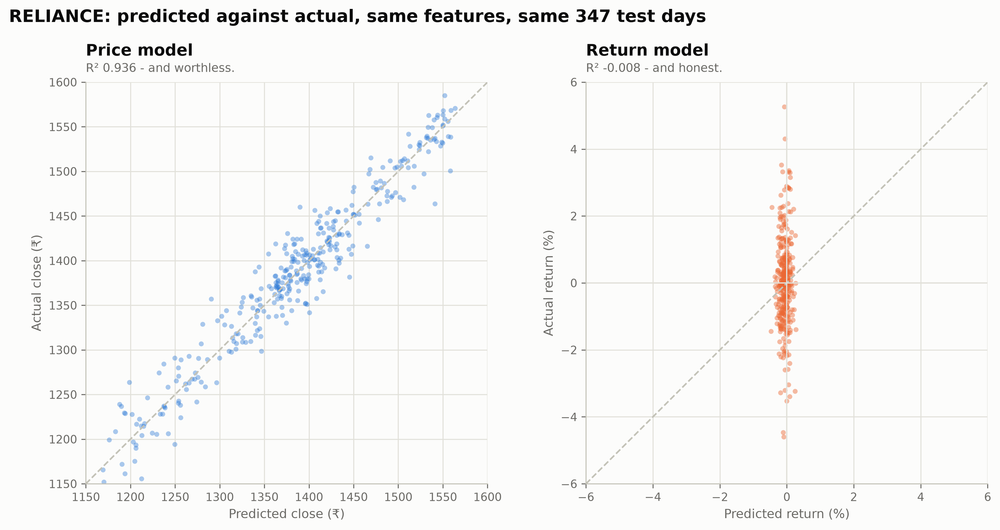

- **Left, the price model.** The dots press so tightly against the diagonal that
  the line is hard to pick out beneath them. It reads as near-perfect prediction
  and is nothing of the kind: the model is answering with approximately today's
  price, and prices move very little overnight. This is autocorrelation wearing
  accuracy's clothes.
- **Right, the return model.** This is the shape of no predictive power.
  Horizontally the cloud barely moves - every prediction sits within half a
  percent of zero. Vertically it covers the entire range of what actually
  happened. Real skill would tilt this into a diagonal cloud along the reference
  line. A vertical band means the predictions carry no information about which
  way the day went.

Plotted as a time series, the same pair looks like a triumph and a failure, and
that reading is exactly backwards:

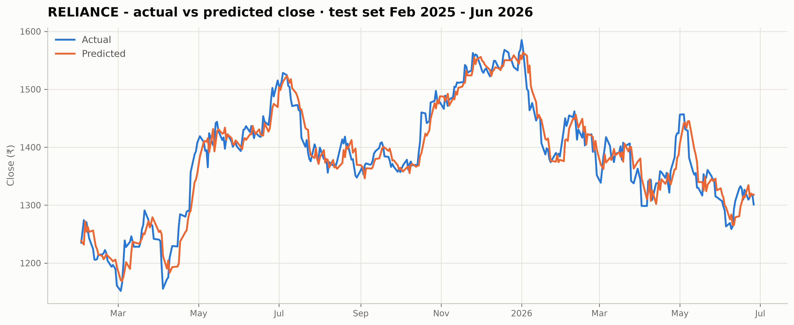

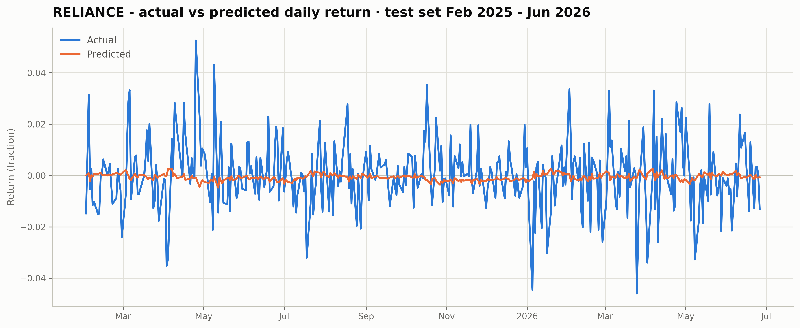

The price chart plots a **level**. To land near ₹1,400 tomorrow, a model only has
to notice that today's price is near ₹1,400, so the orange line traces the blue
one almost perfectly. But the quantity it must get right is enormous compared
with the amount that actually changes overnight: it is scoring well on the ₹1,400
it was handed, not on the ₹13 it was asked to anticipate. Tight tracking is
guaranteed by the question, not earned by the answer.

The return chart plots a **change**, which deletes the part the model was given
for free and leaves only the part in dispute. The blue line swings between -4.6%
and +5.3% while the orange one never leaves a band of about half a percent around
zero.

A flat prediction is also the mathematically correct response to having no
signal. Least squares minimises squared error; when the inputs carry nothing that
anticipates the target, the error-minimising guess is the training mean, and the
mean daily move of a large stock is close to zero. The model is not giving up. It
is being right about how little it knows.

The residuals confirm there is nothing left in there:

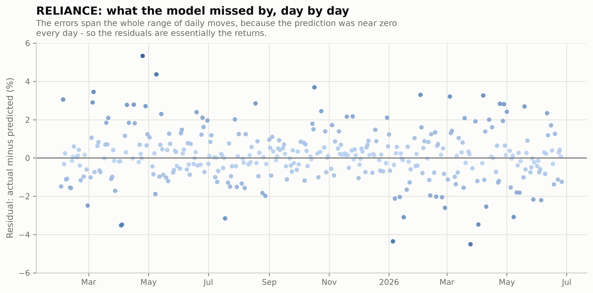

A model with real signal leaves small residuals scattered evenly around zero.
These span the entire range of daily moves, because the prediction was near zero
every day - so the residuals are essentially the returns themselves.

### What each model learned

A linear regression predicts by multiplying each feature by a weight and adding
the results, so the weights are a direct readout of what it leaned on. Drawn on
one shared axis:

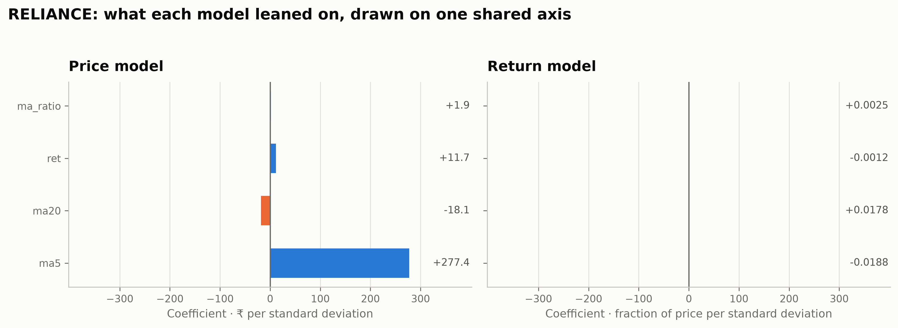

| Feature | Price model (₹ per SD) | Return model (fraction per SD) |
|---|---:|---:|
| `ma5` | +277.43 | -0.0188 |
| `ma20` | -18.10 | +0.0178 |
| `ret` | +11.70 | -0.0012 |
| `ma_ratio` | +1.89 | +0.0025 |

The price model leans hard on `ma5`, not because a 5-day average predicts
tomorrow's direction but because it stands in for today's price, which is most of
the answer to "what will the price be tomorrow". The big bar is the
autocorrelation shortcut showing up in the coefficients: a symptom of the trap,
not evidence of skill.

On the identical axis every return-model bar collapses to a sliver. Note also
that `ma5` at -0.0188 and `ma20` at +0.0178 are near-equal and opposite - the
signature of two collinear features cancelling each other out, which is the
coefficient-level version of "these inputs tell me nothing".

The same fit, drawn as a surface. `ret` and `ma_ratio` are held at their means,
so this is a genuine two-feature slice of the real four-feature model rather than
a separately fitted one:

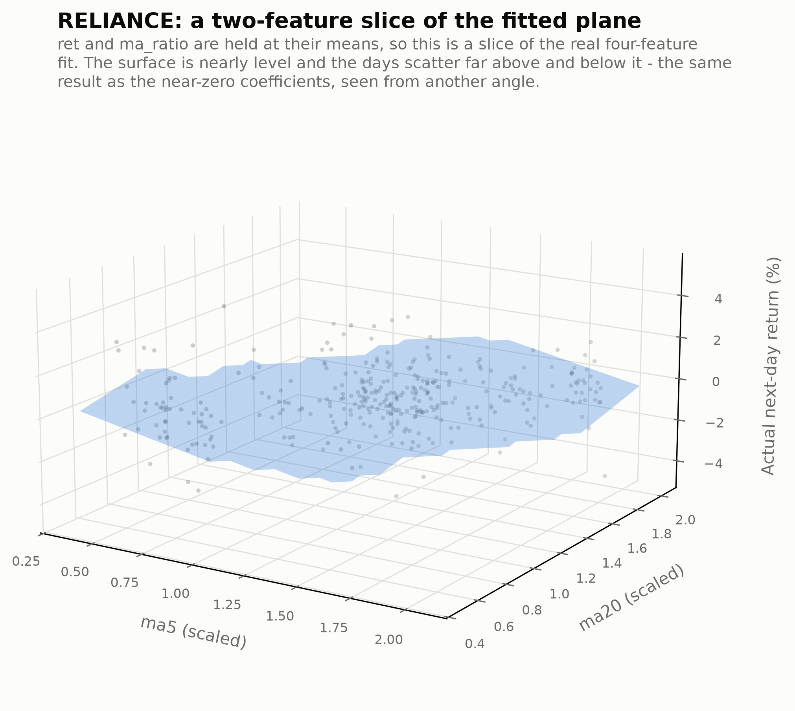

The plane is what the model believes: for any pairing of short-term and
medium-term trend, this is the return it expects. It is nearly level, and the
days scatter far above and below it. A model holding real signal would tilt
steeply with the observations hugging it.

**Why this example is in the report.** Reporting the 0.94 and stopping would have
produced a far more impressive-looking project. It is not reported that way
because R² answers "how much variance did you explain", not "are you useful", and
on an autocorrelated series those two questions come apart completely. Choosing
the benchmark before looking at the score is what keeps the difference visible.

## 6. Interpretation

These results are what the **weak form of the efficient market hypothesis**
predicts. The weak form makes a narrow claim: everything knowable from a stock's
past prices is already reflected in what it costs today. If some shape in the
chart reliably preceded a rise, buyers would move ahead of it until the profit
was gone. The pattern does not vanish - it stops paying.

Moving averages and the golden cross are the extreme case. They are trivial to
compute, taught everywhere, and watched by millions of people with real money,
alongside professional desks running the same arithmetic on faster hardware with
better execution. An edge that survived all of that and was still sitting in
seven years of daily NSE closes, waiting to be found by a linear regression,
would be genuinely surprising. It was not there, which is the unglamorous and
expected answer.

**None of which means momentum never works.** At institutional scale, with
transaction costs near zero and execution measured in milliseconds, edges far too
small to see here can compound into real money. Over three to twelve months,
cross-sectional momentum is one of the better-replicated findings in finance.
What is being claimed is specific: *these four features, in a linear model, on
daily data, across this universe, offer nothing a retail investor could exploit
at human speed once real costs are paid.*

A negative result is still a result. It is also the outcome that was hardest to
fake: every methodological choice in section 3 exists to stop a leak from
manufacturing a positive one.

## 7. Limitations

These are the reasons a reader should discount the conclusion, listed because
they are real rather than because a report is supposed to have a caveats section.

- **Seven years is short for this question.** About 1,750 trading days per stock,
  ~345 held out. That spans several market regimes, which is the minimum for a
  result not to be an artifact of one mood, but published momentum research runs
  on decades and often a century of equity data, precisely because effects this
  small only separate from noise over very long samples. A seven-year window can
  show that a signal is not obviously there. It cannot rule out one that is
  small, slow and real.
- **A linear model only.** If momentum works through thresholds or interactions
  - a golden cross that matters only in calm conditions, say - a straight-line
  fit cannot see it, and would report exactly the null found here.
- **Two uncorrected demergers.** `auto_adjust` repairs splits and bonus issues
  but not demergers. Raymond (2025-05-14, -65%) and Tata Motors (2025-10-14,
  -40%) each show a one-day fall that is a corporate action rather than a market
  move, and both land inside the test period. They are reported rather than
  patched, and they add noise to two of the 98 stocks.
- **`ma_ratio` is collinear with `ma5` and `ma20`.** Its individual coefficient
  is therefore unstable, as noted in 4.4. The directional-accuracy result does
  not depend on it, but the coefficient argument is weaker than it looks.
- **Price returns, not total returns.** Dividends are excluded, so real
  holding-period returns would be higher for the payers.
- **No transaction costs.** This flatters the momentum side. A strategy trading
  daily signals would surrender much of any edge to brokerage, slippage and
  short-term tax, so breaking even here means losing money in practice.
- **An efficiently priced universe.** Mostly large and mid-cap NSE names, among
  the most closely analysed stocks in the market. Finding no edge where theory
  most expects none is a weaker result than finding none in neglected corners.
- **Market-cap labels are anchored at June 2021**, not at the start of the price
  window. They are used only to cut the universe into three bands in 4.5, and a
  stock that changed band mid-window is labelled by its 2021 position.

## 8. What I would do next

- **A longer horizon.** One day is the hardest version of this problem. Three- to
  twelve-month momentum is one of the most replicated results in the literature,
  and testing whether it survives here net of costs would be a better use of the
  same machinery.
- **A genuinely small-cap universe.** The size split hinted at nothing, but 26
  small caps is thin, and the documented premium sits in smaller, less liquid,
  less analysed names than most of these.
- **Fundamental momentum.** Earnings-revision trends and analyst upgrades are
  price-independent signals with real evidence behind them, and they would test
  the same question without reusing a price history already shown to be
  exhausted.
- **Ensemble methods.** Random forests or gradient boosting would capture
  structure a linear fit cannot, but only with walk-forward cross-validation: a
  flexible model on 1,750 rows will cheerfully memorise noise and report a
  wonderful score.
- **Drop `ma_ratio`, or replace it with a cross *event* flag.** Its collinearity
  buys instability for nothing. A binary "crossed in the last n days" feature
  would test the indicator as traders actually use it.

## 9. Reproducing this

The pipeline runs in six stages. `raw_prices.csv` is committed, so stages 2 to 6
reproduce every published number and figure **offline**, with no network and no
dependence on what Yahoo returns today.

```bash
python3 -m venv .venv && source .venv/bin/activate
pip install yfinance pandas numpy scikit-learn matplotlib

# Stage 1 is the only one that hits the network. Skip it to reproduce the
# published results exactly; run it to rebuild the dataset from scratch.
python3 scripts/ml/01_fetch_data.py        # -> scripts/ml/raw_prices.csv

python3 scripts/ml/02_features.py          # -> scripts/ml/reliance_features.csv
python3 scripts/ml/03_split.py             # -> the split figure
python3 scripts/ml/04_model.py             # -> price vs return vs naive, worked example
python3 scripts/ml/05_generate_signals.py  # -> all 98 stocks, results/
python3 scripts/ml/06_figures.py           # -> every figure in docs/figures/
```

Stages 4 and 5 write the JSON the website reads, so the report and the site can
never disagree. Every figure in this README is regenerated by stage 6 from that
same JSON, and every number quoted in the generated summary is computed rather
than typed in.

To run the interactive version locally:

```bash
npm install
npm run dev     # http://localhost:3000
```

There are no environment variables and no API keys. The data is static and ships
in the build.

## 10. Repository layout

```
app/                          Next.js App Router - the interactive report
  page.tsx                    the whole write-up, rendered from data/
  components/
    Charts.tsx                Recharts figures
    CrossDiagram.tsx          golden/death cross, drawn from real Britannia closes
    Hyperplane3D.tsx          the fitted plane, interactive (Plotly, lazy-loaded)
    SectionNav.tsx            scroll-spy anchor nav
lib/
  ml.ts                       typed access to the results, summary statistics
  universe.ts                 ticker -> company name
scripts/ml/
  figstyle.py                 one figure style shared by every stage that plots
  01_fetch_data.py            daily closes for the universe        (network)
  02_features.py              features for the worked example
  03_split.py                 chronological split + figure
  04_model.py                 price vs return vs naive comparison
  05_generate_signals.py      all 98 stocks + the full analysis
  06_figures.py               every findings figure at 300 dpi
  raw_prices.csv              the exact dataset behind every number (committed)
data/
  universe.json               100 tickers -> company names
  market-caps.json            large / mid / small band per ticker
  ml-signals.json             per-stock results
  ml-missing.json             excluded stocks and why
  reliance-model-detail.json  the worked example in full
results/
  RESULTS.md                  the findings as a standalone document
  per-stock.csv               all 98 stocks, machine-readable
  full_analysis.txt           the generated summary, every figure computed
docs/figures/                 all 12 figures, 300 dpi
```

## Notes on the figures

Every figure is regenerated from the committed results by
[`scripts/ml/06_figures.py`](scripts/ml/06_figures.py), so none of them can drift
from the numbers in the tables. They share one style module,
[`figstyle.py`](scripts/ml/figstyle.py).

They use blue and orange rather than the more obvious green and red. Most of
these charts encode a polarity - an edge above or below zero, an R² above or
below zero, a coefficient positive or negative - and green against red separates
by a colour distance of only ΔE 3.5 under deuteranopia, meaning roughly one man
in twelve cannot tell the two bar colours apart. Blue against orange separates by
ΔE 24.7 in the worst case. Polarity is additionally encoded by position in every
chart, so colour is reinforcement rather than the only channel carrying the
value.

## License

MIT. See [LICENSE](LICENSE).
